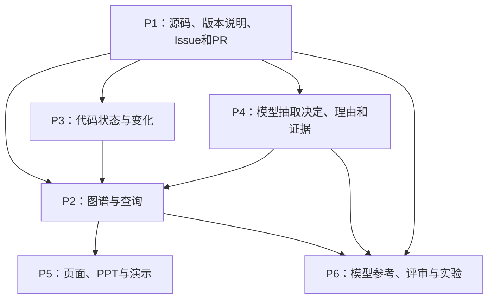

# 总规划与组长使用说明

版本 v4.1｜定稿 2026-10-22｜执行周期：现在至 2026 年 12 月下旬。

## 1. 怎么把任务发出去

先把真实成员对应到 P1–P6，然后每人只发与自己角色对应的那一份 `Pn_…_给成员AI.md`。让成员把整份文件交给其 AI；不要截取章节，不需要把六份都发给每个人。

每份个人文件已经内嵌相同的课程背景、项目范围、全组职责、日程、数据契约、接口、评测规则、示例数据规范和协作协议，并包含该角色自己的具体工作单。它们不依赖本聊天，不要求组员先学习知识图谱再设计方案。

成员首次只需补充自己电脑上的项目目录、已分配的仓库访问方式，以及 AI 真正需要的操作条件。具体软件可以不同。让 AI 按文件先检查现状、随后实际推进，每轮保存进度；不要要求成员自己把规划再解释一遍。

| 文件 | 发给谁 | 主要产物 |
|---|---|---|
| `P1_数据与集成_给成员AI.md` | P1，建议兼组长 | 公共骨架、真实数据、统一接口实现、集成、提交包、统稿 |
| `P2_图谱与查询_给成员AI.md` | P2 | 本体、Neo4j、六类确定性查询 |
| `P3_代码与演化_给成员AI.md` | P3 | API 清单、代码状态、版本事件、模块依赖与提交关联 |
| `P4_模型与知识抽取_给成员AI.md` | P4 | 模型接入或离线批次、决策及理由证据 |
| `P5_原型与汇报_给成员AI.md` | P5 | 四页原型、期中/期末 PPT、讲稿与演示 |
| `P6_标注与实验_给成员AI.md` | P6 | 模型参考标注与自动评审、抽取实验、文本基线对比、图表 |

本文件供组长统筹；`01_统一执行契约.md` 供维护公共标准；个人只读自身文件即可启动。旧的两份规划保留作历史参考，不再与本版共同执行。

## 2. 项目要解决的具体问题

新人能找到 pandas 当前文档，却很难把“API 的存在/弃用/移除”“相关 Issue 和 PR”“实际代码提交”“讨论是否说明了理由”接起来。项目围绕有限的历史范围建立可追溯图谱，让答案能回到原始来源，并明确未知部分。

本项目题目建议：**面向 pandas API 演化与技术决策的可追溯知识图谱构建与应用**。

研究问题：

1. 从代码、版本说明和讨论中可以可靠抽取哪些实体、关系和技术决策？错误主要出在哪里？
2. 显式保存版本、代码、提交、讨论和证据的关系，能否帮助完成跨来源历史查询？
3. 在相同原始语料、问题与回答条件下，图谱检索相对本项目的 BM25 文本 RAG 基线表现如何，有什么代价和局限？

预期贡献是一个有证据、能复现的小型课程系统和诚实实验。无需证明 KG 普遍优于 RAG，也不把节点多当作技术价值。

## 3. 已决定的范围与减负方式

| 维度 | 本版决定 | 理由 |
|---|---|---|
| 项目 | `pandas-dev/pandas` 一个仓库 | 减少不同项目的解析和文档适配成本 |
| 源码快照 | `v1.3.5 / v1.5.3 / v2.0.0` | 聚焦明确历史区间，相关中间发布说明可以补证据 |
| API | 8–12 个，先用 DataFrame.append / Series.append 试跑 | 有代表性且能定位真实证据；最终名单必须核验后冻结 |
| 源码分析 | Python AST 静态读文件 | 不安装或运行历史 pandas；失败显式记录 |
| 关系 | 版本状态、问题/PR/提交/API链、简单作者关系、静态 import、决策证据 | 每条必做关系有明确生产者和消费场景 |
| 原型 | 搜索概览、API历史与理由、关系链/模块依赖、版本比较四页 | 页面数受控，覆盖课程的主要下游任务 |
| 抽取实验 | 有完整来源单元模型参考标注 的决策抽取＋代码状态检查 | 可以正确计算漏检与召回率 |
| 下游对照 | BM25文本RAG vs KG，共用回答模型；受限时做检索层对照并披露 | 保留有解释力的对比，避免四套系统分散精力 |
| 可选扩展 | 长上下文基线、更广 API、自动改名、第二项目 | 只在核心交付全部通过后考虑；不占关键路径 |

既定API清单须覆盖至少一个有明确来源的Bug修复案例，可与跨来源多跳实例共用。P1/P3在11月15日前核验Issue、PR、提交差异与API关联；P4用现有`action=fix`抽取决策，P2/P5展示链路。不增加API数量、节点类型或新的事件枚举，也不把修复伪装成新增/删除事件。

不设“必须 5000 节点/10000 边/十条反对意见/三个失败案例”等凑数验收。实际数据不支持某个结论就返回未知，实际实验不支持优势就如实分析。

## 4. 系统结构与关键交接

```text
P1 采集并冻结原文、版本与提交/讨论关联
       ├──> P3 代码快照、事件、依赖、修改关系
       └──> P4 LLM 决策抽取、理由与证据
P1/P3/P4 的统一 JSONL
       └──> P2 校验、Neo4j、统一查询服务
                    ├──> P5 四页原型
                    └──> P6 KG 评测
冻结的同一原始语料 ────> P6 BM25 文本基线
P6 模型参考标注、预测、评分 ──> 结果表、图表、报告
```

关键原则：P2 提供查询，P5 只展示，P6 直接调用 P2；没有“P6 等 P5 做一个没定义的问答接口”的隐藏依赖。P3 必须交关系而非只有实体表。P4 的理由证据与结论证据分开。

API详情页从P2的timeline响应取得已有Commit/PR/Issue及边、证据，再用返回的Thread ID调用trace；没有Decision也不能丢掉已有修改链。P4/P6的下游回答统一用Answer_v2，正文由程序连接全部断言，评分覆盖同一组断言。P6先以QuestionSet_v1保存问题正文、ID、分组和来源，再生成ReferenceQA_v1参考，避免只有答案编号却没有冻结问题。

全组用 JSONL 交换结构化记录，公共格式只由 P1 实现并与 P2 复核。各 AI 的私有会话、电脑路径、临时数据库不能成为交接依赖。每人交付都附 git 提交、契约版本、数据版本/哈希、运行方法、已验证结果和限制。

## 5. 开发工具差异与模型接入

已确认的配置是：组长使用 macOS，其余五位成员使用 Windows；五位组员有 ChatGPT Plus 或 Pro 订阅；五人使用Codex，另一人使用WorkBuddy或其他具备读写/运行能力的AI；全组六人都有DeepSeek API。全部内容审核使用GPT或DeepSeek。Windows PowerShell 是主要安装说明，macOS 保留对应步骤，两平台都要真实验证。角色编号不绑定操作系统。

成员可以使用各自熟悉的 agent/harness 来开发。AI 首先验证文件读写、命令执行、网络与依赖；不能执行的步骤按小批命令交成员代为操作。订阅登录与 API key 接入有不同的认证和计费条件，不能仅凭 ChatGPT Plus/Pro 推定项目已经配置 OpenAI API，见 [OpenAI 官方认证说明](https://learn.chatgpt.com/docs/auth)。本项目的程序调用默认采用已拥有的 DeepSeek API。

P4 在 10 月 25 日前完成 DeepSeek 最小真实请求，在 10 月 28 日前发布具体模型 ID、实测参数、配置示例和批量成本估算。密钥各自保存在本机 `DEEPSEEK_API_KEY` 中。P4 负责抽取、P6 负责正式实验，其余成员使用冻结结果，无需六人重复运行整套实验。

| 条件 | 执行路线 | 必须记录 |
|---|---|---|
| 默认：DeepSeek API | 实现一个公共适配器，固定输入输出、错误处理和缓存；两组回答用同一模型与参数 | 实际模型/版本、配置、使用量、预算、失败次数 |
| 接口故障且排查后仍阻塞 | P1/P4 登记原因，再启用导出请求、固定工具独立会话执行、导入原始输出的备用批次 | 人工转接、可见模型名、未知版本、无法控制的工具能力 |
| 故障导致无法统一回答模型 | 完成真实 LLM 抽取、图查询及检索层对照 | 完整回答对比未执行，不给混合模型胜负结论 |
| 连真实 LLM 抽取都无法完成 | P1 立即协调接入或机器，不把课程项标完成 | 明确阻塞和未完成范围 |

先完成 DeepSeek 默认通道，不为个人开发软件不同逐个开发适配器。导出/导入保留用于留档和故障备用。图查询自身是确定性程序，核心页面可读取已生成的真实图谱；不把课堂演示依赖于临时在线模型调用。费用开通、账号授权和批量运行预算由实际付费成员处理，AI 不擅自购买服务或索取他人账号凭据。

## 6. 时间安排与全组验收

期中确定为 **2026-11-11，每组5分钟，讲思路和目前进度**；期末约 **12月底**，日期和时长未确定。内部按12月20日形成完整候选交付留出余量。

| 阶段 | 组长验收问题 | 应有证据 |
|---|---|---|
| 10/21–10/25 启动 | 每人能开工吗？共同格式能读吗？DeepSeek 接入实测通过了吗？ | 能力检查、共同骨架、fixture、DeepSeek 连通记录 |
| 10/26–11/01 首轮接通 | 各模块是同一套字段吗？空结果与错误能区分吗？ | fixture贯通、六查询样例、真实试采集 |
| 11/02–11/08 真实小流程 | 至少2个API能从原文走到页面吗？ | 真实来源、抽取输出、图查询、截图、期中PPT |
| 11/11 期中 | 5分钟内讲清问题、方法和已完成部分吗？ | 计时彩排、讲稿、备份截图 |
| 11/12–11/15 冻结范围 | 来源、样本、划分、问题和评分口径确定吗？ | manifest、样本清单、评测协议 |
| 11/16–11/29 方法与模型参考 | 参考和评审可冻结吗？ | 参考生成/复核、开发结果、代码/提示/模型版本 |
| 11/30–12/06 联调 | 用冻结真实数据能重建吗？ | 图谱、原型、错误处理、双平台验证 |
| 12/07–12/13 正式实验 | 每个数字可从原表重算吗？ | 正式预测、评分、统计脚本、逐题表 |
| 12/14–12/20 交付候选 | 报告各章、数据、代码与演示相互一致吗？ | 报告PDF、PPT、复现包、贡献与互评 |
| 期末通知后 | 实际提交日期、格式和现场设备确认了吗？ | 最终清单与彩排 |

P1 每周收一次每人的状态文件及交接包，检查实际产物而非口头百分比。对影响他人的接口问题当天分配处理；其他问题按下一次工作日跟进。期中前优先小闭环，期末前优先实验与复现，不临时增加新系统。

## 7. 模型评审与本人工作量

初始实验预算为：40个完整来源单元（10开发/30测试）；24个API×版本状态样本（8开发/16测试）；24道问题（4开发/20测试）。讨论与QA按主题分组，避免同一事件换个页面泄漏；代码状态采样口径见契约与P6文件。

全部参考标注与内容审核由GPT或DeepSeek完成，程序检查格式、引文位置、关系及指标运算。P6先让独立模型请求阅读完整原文建立参考，再冻结参考、运行生产预测、进行盲化评审；参考生成不能先看生产答案。报告称模型参考/银标及模型评分，不称人工金标。具体输入输出、分歧、覆盖率与指标规则见统一契约C8。

独立请求表示输入和会话隔离，不保证评审误差独立；同一模型生成参考、作答与评分时可能共享偏差。保留全模型评审路线，报告明确实际生产/参考/评审模型及结论边界，不把重复一致视为人工验证或普遍准确率。

| 工作 | 主责AI | 其他角色配合 |
|---|---|---|
| 审核通道与日志 | P4提供GPT/DeepSeek网关，P6定义评审提示 | 各模块提供可追溯输入与实际运行结果 |
| 讨论/代码/QA参考与独立复核 | P6 | P1提供冻结原文，P3提供源码定位 |
| 抽取匹配、证据支持与QA盲评 | P6 | P4交正式预测，P2交查询结果 |
| 工程检查、独立模型复核与集成 | 各模块AI自检，P1组织整合 | 缺陷由所属模块AI修复 |

本人时间预算（整个项目，含与AI沟通、配置、阻塞、交接、写作和汇报；不计机器独自等待）：

| 角色 | 本人总预算 | 主要压力 |
|---|---:|---|
| P1 | 35–55小时 | 公共基础、采集、集成、统稿与打包，贯穿全程 |
| P2 | 25–40小时 | 图语义、六类查询及上下游联调 |
| P3 | 20–35小时 | 源码定位、版本变化、提交和依赖关联 |
| P4 | 20–35小时 | 生产/审核模型接入、抽取与失败处理 |
| P5 | 15–25小时 | 四页原型、PPT、讲稿与实际演示 |
| P6 | 25–40小时 | 模型参考、自动评分、BM25和实验写作 |

前提是审核能批量执行，首轮实际流程后按计时调整。现有核心模块归属保持不变，P1仍偏重、P5相对轻；本人不逐条人工审核内容。P1不兜底替其他人写模块，每个角色的AI负责修复自己交付的问题。需要再分配核心任务时同步所有权和六份文件，不只口头交办。

## 8. 报告写作分工与篇幅

本节就是完整的报告分工依据，不依赖尚不存在的第三份“报告撰写分工”。参考结构可微调，课程规定部分不能缺。

| 章节 | 主责 | 建议字数 | 必须回答/提交 |
|---|---|---:|---|
| 摘要 | P1，最后写 | 250–350 | 问题、方法、真实规模、实测结果、限制 |
| 引言 | P1 | 600–800 | 具体历史查询难点、为什么需要结构关联、研究范围 |
| 相关工作 | P2统合，各人供来源 | 400–600 | KG/软件历史/LLM抽取/检索对比，正文实际引用 |
| 任务定义 | P2+P6 | 400–500 | 输入输出、抽取单位、六查询、评测任务与边界 |
| 数据集与图谱构造 | P1+P2 | 900–1100 | 采样、快照、来源冻结、图模式、真实统计与质量 |
| 方法 | P2+P3+P4 | 1400–1800 | 图表示、代码状态、关联、决策与证据、运行通道 |
| 实验：知识抽取及下游 | P6主笔，P3/P4提供细节 | 1300–1700 | 模型参考、划分、指标、条件、结果、案例与局限 |
| 原型系统 | P5 | 700–900 | 四页真实使用路径、截图、异常/离线说明 |
| 结论与局限 | P6+P1 | 300–400 | 仅支持实测范围的结论，未实现项和人工参与 |
| 人员与工作安排 | P1收集全员 | 200–300 | 角色、真实交付、时间、贡献依据 |
| 组内互评 | 每人独立填，P1汇总 | 按实际情况 | 交付、协作、实验/文档贡献与具体事实 |
| 参考文献 | P2统一格式 | 不计入正文 | 可查来源、正文引用位置，禁止虚构 |

目标正文6500–8500字，章节建议合计可能随实际内容调整；最终以真实字数检查≥5000为准，不能把表中目标当已达标。每人准备与自己方法相关的2–3项可靠来源，P2去重统一；官方文档和研究论文区别标明，引用数量不代替质量。

每人个人文件均附本人的写作责任、提交日期和最低素材清单。开发期不断积累；11月29日前交方法草稿，12月13日前交实验/原型完整素材，12月17日前P1完成合稿，12月20日前由各角色AI完成事实、图表、引用与PDF的GPT/DeepSeek复核，全员准备实际汇报。

组内互评建议四项各1–5分：交付完成与质量、协作响应、实验/自动审核贡献、报告/展示贡献，每项附一条事实；不由AI替成员编评价。组长组织成员读懂自己模块，并能解释一个真实样例和一个限制。

## 9. 期中5分钟怎么讲

默认一人主讲，至多另一人操作；不安排六人依次自我介绍。建议五页、彩排4分30秒：

1. 问题与目标（约35秒）：一个API历史问题，指出当前资料分散。
2. 数据与图谱方案（约55秒）：几类来源、显式关系与证据如何连接。
3. 已完成进度或真实小演示（约90秒）：展示一条有来源的真实查询，未完成项如实说明。
4. 分工与进度（约55秒）：各模块产物、已经接通哪些环节。
5. 实验思路与下一步（约35秒）：模型参考、对比方案、主要风险和期末目标。

现场切换失败时使用预先保存的真实截图，说明它来自哪个数据版本；不能把合成fixture演示成真实pandas结果。正式期末时长待课程通知后由P5重新编排。

## 10. 风险、降级与不能省的内容

| 情况 | 先做什么 | 不能冒称什么 |
|---|---|---|
| DeepSeek接口、网络或额度受限 | P4定位实际错误；其他模块用缓存推进；必要时登记并启用备用批次 | 不能把未运行请求写成已完成，也不能混模型比较 |
| 源码难定位或讨论过长 | 冻结前缩小候选范围，保留失败/排除记录 | 不能删测试难例后报更好成绩 |
| 缺少明确理由 | rationale=null，仍展示事件事实与证据 | 不能从代码变化推测动机 |
| 图链不完整 | 返回已有路径与缺口，P1定向补证据 | 不能把提及补成解决关系 |
| 数据库或网络临场不可用 | 显示标识明确的冻结真实缓存和截图 | 不能把重放延迟当实时性能 |
| 参考生成/评审失败或分歧多 | 检查覆盖和实际错误，按冻结规则处理；未知与失败单列 | 不能只审核已输出项算召回，也不能隐藏未评估样本 |
| 模型或方法改变 | 新版本留痕，受影响实验整组重跑 | 不能混不同条件得出系统优劣 |
| 最终时间提前 | 先取消全部可选扩展，核心范围按变更流程调整 | 不能省LLM抽取、显式图、真实实验及课程提交项 |

## 11. 最终提交包与复现口径

P1打包 `submission/`，清单至少包含：

```text
README.md                      # 环境、启动、数据/模型条件、复现步骤及人工环节
report.pdf                     # 全部规定部分，字数核验
slides_midterm.pptx             # 期中实际展示版本
slides_final.pptx               # 期末版本
code/                          # 干净源码、锁文件、配置模板、测试
dataset/                       # 冻结来源/清单、API映射、图记录、许可与来源说明
evaluation/                    # 开发和最终发布的测试参考、预测、原始评分、统计与图表
model_runs/                    # 实际LLM输入输出、提示版本/工具模式/已知模型信息
demo/                          # 真实缓存、截图、演示脚本与启动清单
contributions/                 # 成员交付与互评
```

区分三个复现层次：①无需重新调用模型，重算已交付预测/评分的实验数字；②用冻结图记录重建Neo4j与页面；③重新调用外部模型重新抽取。前两项应可完成；第三项可能受账号、模型版本、服务变化影响，应说明条件，不能承诺绝对相同输出。

不要只交脚本加一组源站URL，导致他人拿不到当时真正评测的输入。也不要把整份git历史或无关评论全部塞进包：交付实际使用的必要冻结材料及来源说明，体积由P1记录和控制。课程未要求独立训练模型，本项目交付代码、提示与模型运行记录即可说明所用方法。

## 12. 如何维护这套规划

六份个人文件的公共段包含相同契约版本和SHA-256。改共享接口时，先改统一契约，再同步所有个人文件并重新校验；只改某一份会造成下一次分发不一致。个人任务内部实现细节由其AI决定，不为常规实现选择反复召集讨论。

本次只交付规划和验收规范，没有预先创建系统代码、真实数据、模型结果或实验数字。第一次执行时，各角色AI应按文件逐项创建并验证，保留证据。实际期末日期、成员姓名/角色、仓库邀请、开发工具实际能力、DeepSeek 具体模型与连通/额度/预算是启动阶段由指定负责人核验的事实，并非遗漏给AI自由猜测的条件。

## 13. GitHub合作的具体做法

作业仓库：[Charlie-Yong/pandas-kg-archaeologist](https://github.com/Charlie-Yong/pandas-kg-archaeologist)，私有。各人在自己电脑的独立副本开发，AI负责同步、检查、提交和PR；无需同时在线。首次登录与仓库邀请由成员配合，实际角色、GitHub用户名和合并权限由P1登记。

本人分支feat/p1至feat/p6→小批提交与handoff→PR→P1的AI组织程序检查及独立GPT/DeepSeek复核→普通合并提交到main→接收方AI同步共同版本。长期个人分支不用squash/rebase合并、不自动删除；合并后继续将origin/main合入本人分支。缺陷退回所属AI修复。P1自己的交付也走检查；保护规则或权限阻止合并时说明实际原因，不宣称已经完成。

以append为例：P1先交一批原文；P3分析三个版本、P4抽取讨论并行；P2接收事实建图；P5做页面、P6运行模型评审与对照并行。前后批次交错推进。GitHub保存共同文件，不共享私人AI会话；恢复工作看STATUS、交付说明和实际版本。



每位成员收到的个人文件已经包含上述协作协议、仓库地址和评审规则；成员只需交给自己的AI。Codex或WorkBuddy实际能力缺项时AI提供具体补齐步骤，不要求该成员改用另一品牌才开工。
